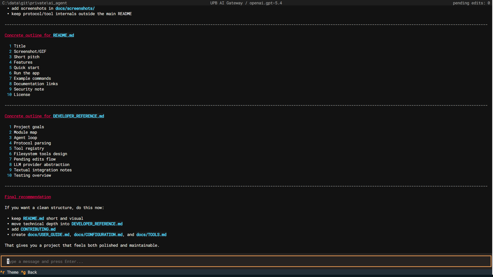
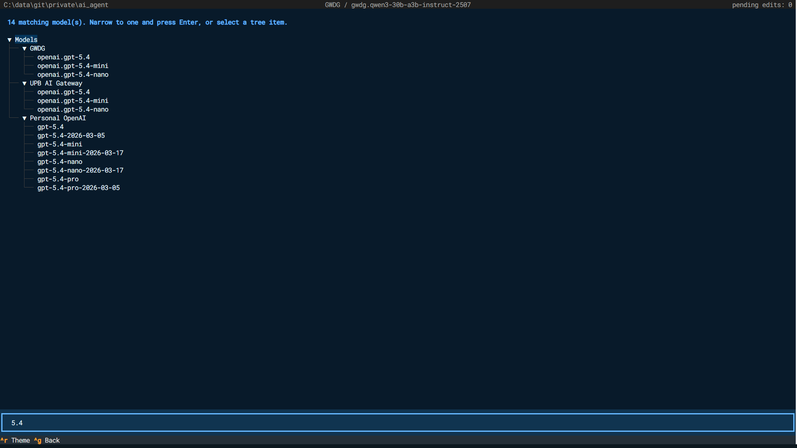
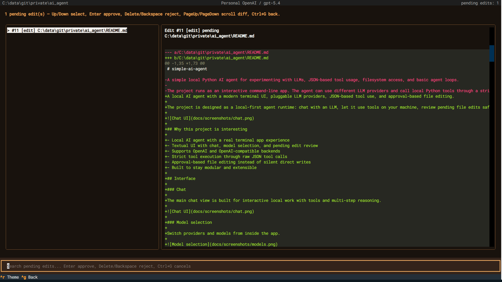

# simple-ai-agent

A local-first coding agent with a Textual terminal UI, pluggable LLM backends, tool calling, persistent chat history, and approval-based file operations.

The project is independent and is not affiliated with any university, research institution, or model provider.



## Highlights

- Textual terminal UI with chat, model switching, chat history, and pending-change review
- OpenAI Responses API, OpenAI-compatible Chat Completions, Anthropic Claude Messages API, and Google Gemini through Vertex AI
- Native tool calling where supported, with a JSON protocol fallback
- Bounded, fail-fast tool batches
- Exact-match file edits that remain pending until explicitly approved
- Pending create, replace, move, copy, and delete operations
- Filesystem, Python AST, HTTP, safe shell, and knowledge-search tools
- Local knowledge routing and optional Qdrant-backed indexes
- PDF-to-Markdown reading through PyMuPDF4LLM

## Requirements

- Python 3.11 or newer
- An API key for key-based providers, or Google Cloud Application Default Credentials for Vertex AI

## Installation

```bash
python -m venv .venv
```

Activate the environment:

```powershell
# Windows PowerShell
.venv\Scripts\Activate.ps1
```

```bash
# macOS/Linux
source .venv/bin/activate
```

Install dependencies:

```bash
python -m pip install -r requirements.txt
```

For tests:

```bash
python -m pip install -r requirements-dev.txt
```

## Provider configuration

Copy the example files:

```bash
cp providers.example.toml providers.toml
cp .env.example .env
```

PowerShell equivalents:

```powershell
Copy-Item providers.example.toml providers.toml
Copy-Item .env.example .env
```

Keep secrets in `.env`; `providers.toml` should reference them by environment-variable name.

OpenAI Responses API example:

```toml
[[providers]]
key = "openai"
label = "OpenAI"
api_type = "responses"
api_key_env = "OPENAI_API_KEY"
default_model = "gpt-4.1-mini"
supports_model_listing = true
```

### Anthropic Claude (Messages API)

Set these variables in the **backend's** `.env` (keep the real key out of chat and TOML):

```dotenv
ANTHROPIC_API_KEY=your-key
ANTHROPIC_BASE_URL=https://api.anthropic.com/v1/messages
ANTHROPIC_DEFAULT_MODEL=claude-opus-5-5
```

When `ANTHROPIC_API_KEY` is present, **Anthropic Claude** is registered automatically if you haven't already configured an Anthropic provider in `providers.toml`. For explicit configuration, see the `anthropic_messages` entry in `providers.example.toml`. The base URL and default model are optional; the stock endpoint and `claude-opus-5-5` are used by default. For the base URL, a service root or a URL ending in `/v1` or `/v1/messages` is accepted.

After installing the updated requirements and restarting the backend (or the local app), select **Anthropic Claude** in `\models`. The picker uses Anthropic's Models API; you can also select the default or enter a model ID manually. Claude uses native tool calls, with the same app-level review and approval rules as other providers.

In `\settings`, choose **Anthropic reasoning effort**: **Default**, `low`, `medium`, `high`, `xhigh`, or `max`. Default omits the effort parameter; it doesn't disable thinking. Claude Opus 5.5 supports all five levels and defaults to `medium`. Not every model supports every level; the app shows Anthropic's error rather than silently changing your selection. This setting is independent of OpenAI reasoning effort and does not change the approved Night Shift worker policy.

The output limit (`max_tokens`, covering thinking plus reply) is 64,000 tokens at `xhigh` and `max`, as Anthropic recommends, and 32,768 otherwise when effort is set or for Claude Opus 5.5. Requests use prompt caching: the tools and system prompt, plus a rolling breakpoint on the newest turn, are cached so long conversations and tool loops reuse their prefix at the reduced cached-input price. If Claude declines a request or the conversation exceeds its context window, the app shows a clear error instead of an empty reply.

### Google Gemini through Vertex AI and Application Default Credentials (ADC)

```toml
[[providers]]
key = "gemini_vertex"
label = "Google Gemini (Vertex AI / ADC)"
api_type = "gemini_vertex"
project_env = "GOOGLE_CLOUD_PROJECT"
location = "global"
default_model = "gemini-2.5-flash"
supports_model_listing = true
```

Install the Google Cloud CLI, enable Vertex AI in the project, and authenticate once:

```bash
gcloud auth application-default login
gcloud config set project YOUR_PROJECT_ID
gcloud services enable aiplatform.googleapis.com --project YOUR_PROJECT_ID
```

Then set `GOOGLE_CLOUD_PROJECT=YOUR_PROJECT_ID` and `GOOGLE_CLOUD_LOCATION=global` in `.env`. The global endpoint is required for some Gemini 3.x models that appear in regional catalogues but cannot be invoked from those regional endpoints. No Gemini API key is stored by this application. For local development ADC uses the credential file managed by `gcloud`; deployed environments should use an attached service account/workload identity instead.

Gemini models are discovered through the Vertex AI catalogue and filtered to generative Gemini models. If catalogue access fails, the configured `default_model` remains available. Gemini currently uses the agent's JSON tool-call protocol rather than Gemini-native function calling.

Generic OpenAI-compatible example:

```toml
[[providers]]
key = "openai_compatible"
label = "OpenAI-Compatible API"
api_type = "chat_completions"
api_key_env = "OPENAI_COMPATIBLE_API_KEY"
base_url_env = "OPENAI_COMPATIBLE_BASE_URL"
default_model_env = "OPENAI_COMPATIBLE_DEFAULT_MODEL"
supports_model_listing = true
```

Corresponding `.env` values:

```dotenv
OPENAI_API_KEY=your-key
OPENAI_COMPATIBLE_API_KEY=your-key-or-placeholder
OPENAI_COMPATIBLE_BASE_URL=http://localhost:1234/v1
OPENAI_COMPATIBLE_DEFAULT_MODEL=your-model
```

The app prefers the `openai` provider when present, otherwise the first configured provider. If that choice lacks credentials or a default model, a configured Anthropic provider with both can be used for startup.

Never commit `.env`, `providers.toml`, credentials, or private chat data.

## Run

Start the server and Textual in **separate terminals**. Generate a private token once:

```bash
python -c "import secrets; print(secrets.token_urlsafe(32))"
```

Set the same token in both terminals (PowerShell):

```powershell
$env:AI_AGENT_TOKEN = "<generated token>"
```

Server terminal, on the PC with your providers and files:

```bash
python -m runtime.server
```

Client terminal:

```bash
python main_textual.py
```

Textual connects to `http://127.0.0.1:8765` by default. Multiple clients share one live
conversation. Closing Textual disconnects only the interface; keep the server process
running. The server checkpoints context, ordinary proposals, recent events and execution
records in `.agent_runtime/runtime.sqlite3` (single writer; keep this private). Restarts
restore state, not execution: interrupted commands are marked unknown and never retried
automatically. Coherent OpenAI Responses continuation is restored; interrupted chains
start fresh from safe context with visible recovery evidence. Privileged grants are never
restored. Orderly server shutdown waits for ordinary work. The first upgrade cannot save
state held only in the old server's memory. Embedded `--local` mode remains volatile.
The Python entrypoints do not install or change Windows services or scheduled tasks.

For another device, use Tailscale Serve to proxy private HTTPS to `127.0.0.1:8765`,
start the server with `--allowed-host YOUR-PC.YOUR-TAILNET.ts.net`, and set
`AI_AGENT_SERVER=https://YOUR-PC.YOUR-TAILNET.ts.net` plus the same token on the client.
Keep the Serve endpoint tailnet-only; do not enable Funnel. The server listens only on
loopback. Authentication is required even over Tailscale; the shared token grants ordinary
agent/file-approval access, not a filesystem sandbox. Rotate it by restarting the server
with a new token. Browser-origin API requests are currently rejected.

### Existing Windows browser startup

The Windows launcher `scripts/start_backend.ps1` starts the backend as an ordinary user.
The operator's local `start_all_silent.ps1` / `start_all_visible.ps1` launch it before
Textual Serve; `start_textual.ps1` waits for authenticated backend readiness. Existing
Caddy/Authelia routing and the browser URL stay unchanged; port 8765 stays on localhost.
The existing scheduled-task trigger is unchanged (a logon task starts at login, not before login).

The launchers share an automatically generated, per-Windows-user DPAPI-encrypted token in
`.agent_runtime/startup-token.dpapi`, unless `AI_AGENT_TOKEN` is explicitly provided in their
process environment. No plaintext token is put in a script, command line or log. Run both
launchers under the same Windows account. These Windows launchers set local connection
settings explicitly; they do not take their token from `.env`. Backend startup failures
are in `logs/backend-*.err.log`; running the stack again does not replace an existing backend.
The local `stop_all.ps1` stops web access but deliberately leaves the agent backend running.

The machine-specific Caddy/Authelia/stack scripts remain Git-ignored; the reusable
`agent_startup.ps1` and `start_backend.ps1` are tracked. No live processes are restarted by editing them.

Privileged/UAC workflows are **not exposed remotely**. For the original trusted local
interface, explicitly set `AI_AGENT_MODE=local` before starting Textual. That mode still
owns an in-process runtime and stops when its hosting process closes.

The main views support:

- provider/model selection
- runtime model settings, including proposal-diff output control
- persistent chat selection
- pending operation review and approval
- working-directory navigation
- light/dark theme switching





## Tooling

The agent can:

- navigate, read, find, and search local files
- extract PDFs as Markdown
- inspect Python modules with the AST
- propose file edits and filesystem operations for approval
- run a small OS-specific unelevated shell-command allowlist
- request Administrator commands through [per-command pending approval and UAC](docs/elevated_commands.md),
  after separate protected-launcher installation (Windows; maximum command execution: 60 seconds)
- fetch public HTTP(S) URLs
- search configured local knowledge sources and chat history

Relative paths resolve against the active working directory. Absolute paths are supported.

## File-operation safety

Mutation tools do not write immediately. They create pending operations that must be approved in the UI. Exact-match edits are replayed against the latest file content at approval time and are rejected when changes overlap or the expected text is no longer uniquely present.

This protects against accidental writes, but it is not a sandbox. Read tools, approved operations, and allowed shell commands run with the permissions of the Python process.

## Knowledge search

`knowledge_search` routes a query across configured local capabilities. It can use local keyword stores and optional Qdrant indexes for capability routing, chat history, and long-term memory.

Configuration lives in `config/knowledge.yaml`. Qdrant can run through the client's local persistent mode or through the localhost-only service in `docker-compose.qdrant.yml`.

Embedding and index data stay local unless you explicitly configure otherwise. The selected LLM provider can still receive tool observations as conversation context.

## Commands

- `\help` — command overview
- `\models` — select a provider/model
- `\settings` — configure runtime behavior, including proposal-diff results, OpenAI Flex processing, reasoning effort, and [one-turn privileged Hyper-V evidence](docs/privileged_hyperv_evidence.md) (fixed read-only operation; separate protected setup and UAC consent required)
- `\chats` — browse saved chats
- `\new_chat` — start a new chat
- `\history` — list recent chats
- `\pending` — review and resolve pending operations
- `\pwd` / `\cd <path>` — inspect or change the working directory
- `\state` — show runtime state
- `\reset` — reset the active conversation
- `\theme` — switch the color theme
- `\quit` — quit

## Development

Run the tests:

```bash
python -m pytest -q
```

Optional checks:

```bash
ruff check .
mypy .
```

## Security

- There is no filesystem sandbox.
- File and PDF contents read by tools may be sent to the selected LLM provider.
- The HTTP tool blocks local/private destinations.
- Shell execution is restricted to an explicit command allowlist, not fully isolated.
- Review every pending operation before approval.
- Keep local credentials and history out of version control.

## License

MIT
